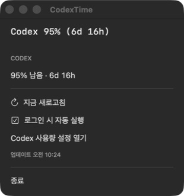
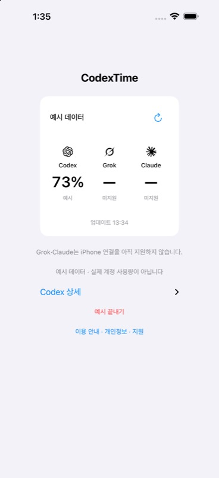

# CodexTime

[](https://github.com/sundaynighttt/codextime/actions/workflows/ci.yml)
[](https://github.com/sundaynighttt/codextime/releases/latest)
[](LICENSE)

Codex를 쓰다 보면 남은 사용량과 리셋 시간을 확인하기 위해 매번 설정 화면을 열어야 합니다.

**그게 불편해서 만들었습니다.**

CodexTime은 지원하는 AI 서비스의 남은 사용량과 리셋까지 남은 시간을 짧게 보여주는 무료 오픈소스 앱입니다.

- **macOS:** Codex · Grok · Claude를 기본 표시하고 서비스별 숨김·조회 중지 선택, 필요하면 리셋 시간도 함께 표시
- **Windows — Codex 전용:** 작업표시줄에 `Codex 95% · 6d 16h` 표시
- **iPhone:** 작은 3열 카드·위젯, Codex 직접 조회와 Grok·Claude 공식 웹 수동 확인. 1.0(14)는 로그인 웹 영역을 확대
- Windows에서는 우상단 미니 위젯으로 전환 가능
- 별도 OpenAI API 키 불필요
- 광고·분석·텔레메트리 없음

> CodexTime은 서비스 제공자의 공식 제품이 아닌 커뮤니티 프로젝트입니다. Codex CLI·계정 사용량 인터페이스와 macOS의 추가 공급자 연결을 사용하며, 외부 서비스 변경에 따라 수정이 필요할 수 있습니다.

<!-- project-release-ledger:start -->
## 릴리스 기준과 전체 버전 흐름

> 자동 관리 원장: [`docs/releases/release-ledger.json`](docs/releases/release-ledger.json) · 갱신일: `2026-10-19`

### 현재 기준선

| 기준 | 버전 | 단계 | 상태 | 요약 | 근거 |
| --- | --- | --- | --- | --- | --- |
| iPhone 최신 후보<br>`latest_candidate` | **`1.0 (14)`** | `external_processed` | `passed` | 웹 로그인 영역 확대·조작 패널 접기·키보드 대응; iPhone17e 빈 폼·42 XCTest·Release 서명, 21:39업로드·21:42~43 Apple 처리/Internal1명·21:44안내 저장 확인 | [project.yml](ios/project.yml)<br>[2026-10-19-ios-web-height.md](docs/releases/2026-10-19-ios-web-height.md)<br>[submission.md](docs/app-store/submission.md)<br>`git:da7d762`<br>[외부 근거](https://appstoreconnect.apple.com/teams/8874948e-3fee-4bea-a414-67a4c0f0e7d8/apps/6805935440/testflight/ios/9b6de1a7-c183-4198-a084-9dfe9be7182a) |
| Apple 처리 확인 최신<br>`last_external` | **`1.0 (14)`** | `external_processed` | `passed` | 웹 로그인 영역 확대·조작 패널 접기·키보드 대응; iPhone17e 빈 폼·42 XCTest·Release 서명, 21:39업로드·21:42~43 Apple 처리/Internal1명·21:44안내 저장 확인 | [project.yml](ios/project.yml)<br>[2026-10-19-ios-web-height.md](docs/releases/2026-10-19-ios-web-height.md)<br>[submission.md](docs/app-store/submission.md)<br>`git:da7d762`<br>[외부 근거](https://appstoreconnect.apple.com/teams/8874948e-3fee-4bea-a414-67a4c0f0e7d8/apps/6805935440/testflight/ios/9b6de1a7-c183-4198-a084-9dfe9be7182a) |
| 데스크톱 공개 최신<br>`latest_desktop_release` | **`0.3.0 (2026101906)`** | `released` | `active` | macOS 세 서비스 표시·조회 선택과 본인 계정 설정 공개; 99 tests·전체 CI·서명·공증 universal DMG·비로그인 다운로드 및 체크섬 검증 통과 | [2026-10-19-v0.3.0.md](docs/releases/2026-10-19-v0.3.0.md)<br>[macos-setup.md](docs/macos-setup.md)<br>[build-macos.sh](macos/scripts/build-macos.sh)<br>[release.yml](.github/workflows/release.yml)<br>[외부 근거](https://github.com/sundaynighttt/codextime/actions/runs/39195054137)<br>[외부 근거](https://github.com/sundaynighttt/codextime/releases/tag/v0.3.0)<br>[외부 근거](https://github.com/sundaynighttt/codextime/actions/runs/39195689279) |
| macOS 로컬 설치·실행 확인<br>`last_installed_smoke` | **`0.3.0 (2026101906)`** | `released` | `active` | macOS 세 서비스 표시·조회 선택과 본인 계정 설정 공개; 99 tests·전체 CI·서명·공증 universal DMG·비로그인 다운로드 및 체크섬 검증 통과 | [2026-10-19-v0.3.0.md](docs/releases/2026-10-19-v0.3.0.md)<br>[macos-setup.md](docs/macos-setup.md)<br>[build-macos.sh](macos/scripts/build-macos.sh)<br>[release.yml](.github/workflows/release.yml)<br>[외부 근거](https://github.com/sundaynighttt/codextime/actions/runs/39195054137)<br>[외부 근거](https://github.com/sundaynighttt/codextime/releases/tag/v0.3.0)<br>[외부 근거](https://github.com/sundaynighttt/codextime/actions/runs/39195689279) |

### 전체 버전 흐름

| 순서 | 날짜 | 버전 | 단계 | 상태 | 요약 | 근거 |
| ---: | --- | --- | --- | --- | --- | --- |
| 1 | 2026-08-26 | `v0.1.0` | `released` | `historical` | 최초 macOS 공개 배포 | `git:v0.1.0`<br>[외부 근거](https://github.com/sundaynighttt/codextime/releases/tag/v0.1.0) |
| 2 | 2026-08-26 | `v0.1.1` | `released` | `historical` | macOS 서명·공증 공개본 | `git:v0.1.1`<br>[외부 근거](https://github.com/sundaynighttt/codextime/releases/tag/v0.1.1) |
| 3 | 2026-08-26 | `windows-v0.2.0` | `released` | `historical` | Windows 상시 표시 WPF 사전 배포 | `git:windows-v0.2.0`<br>[외부 근거](https://github.com/sundaynighttt/codextime/releases/tag/windows-v0.2.0) |
| 4 | 2026-08-26 | `v0.2.0` | `released` | `historical` | 한국어 중심 공개 안내 및 데스크톱 배포 | `git:v0.2.0`<br>[외부 근거](https://github.com/sundaynighttt/codextime/releases/tag/v0.2.0) |
| 5 | 2026-08-26 | `v0.2.1` | `released` | `historical` | 설치 앱 아이콘 추가 | `git:v0.2.1`<br>[외부 근거](https://github.com/sundaynighttt/codextime/releases/tag/v0.2.1) |
| 6 | 2026-08-26 | `v0.2.2` | `released` | `historical` | 간결한 사용량 표시 설정 | `git:v0.2.2`<br>[외부 근거](https://github.com/sundaynighttt/codextime/releases/tag/v0.2.2) |
| 7 | 2026-08-26 | `v0.2.3` | `released` | `historical` | macOS 메뉴바 표시 복구 | `git:v0.2.3`<br>[외부 근거](https://github.com/sundaynighttt/codextime/releases/tag/v0.2.3) |
| 8 | 2026-08-28 | `0.3.0 (1)` | `external_processed` | `historical` | 최초 iPhone 전용·암호화 설정 및 내부 전용 테스트; 2026-09-04 ASC 처리 상태 확인, 설치 수만으로 smoke 통과를 추정하지 않음 | `git:4a58f5a`<br>[submission.md](docs/app-store/submission.md) |
| 9 | 2026-08-28 | `0.3.0 (2)` | `external_processed` | `historical` | 일반 TestFlight 업로드 빌드; 2026-09-04 ASC 처리 상태 확인, 설치 수만으로 smoke 통과를 추정하지 않음 | `git:24be6f8`<br>[submission.md](docs/app-store/submission.md) |
| 10 | 2026-08-28 | `0.3.0 (3)` | `external_processed` | `historical` | 기기 로그인 대기 유지; 2026-09-04 ASC 처리 상태 확인, 설치 수만으로 smoke 통과를 추정하지 않음 | `git:eb80e99`<br>[submission.md](docs/app-store/submission.md) |
| 11 | 2026-08-28 | `0.3.0 (4)` | `external_processed` | `historical` | 위젯 새로고침 버튼; 2026-09-04 ASC 처리 상태 확인, 설치 수만으로 smoke 통과를 추정하지 않음 | `git:13a95d9`<br>[submission.md](docs/app-store/submission.md) |
| 12 | 2026-08-28 | `0.3.0 (5)` | `external_processed` | `historical` | 위젯 갱신 시각 표시; 2026-09-04 ASC 처리 상태 확인, 설치 수만으로 smoke 통과를 추정하지 않음 | `git:cd2139c`<br>[submission.md](docs/app-store/submission.md) |
| 13 | 2026-08-30 | `0.3.0 (6)` | `external_processed` | `historical` | 위젯 누적 토큰 표시; 2026-09-04 ASC 처리 상태 확인, 설치 수만으로 smoke 통과를 추정하지 않음 | `git:df50a6e`<br>[submission.md](docs/app-store/submission.md) |
| 14 | 2026-09-03 | `0.3.0 (7)` | `external_processed` | `historical` | 위젯 새로고침 버튼 정렬; 2026-09-04 ASC 처리 상태 확인, 설치 수만으로 smoke 통과를 추정하지 않음 | `git:d9f37ad`<br>[submission.md](docs/app-store/submission.md) |
| 15 | 2026-09-03 | `0.3.0 (8)` | `external_processed` | `historical` | 위젯 갱신 시각을 제목 오른쪽 괄호로 이동; 2026-09-04 ASC 처리 상태 확인, 설치 수만으로 smoke 통과를 추정하지 않음 | `git:df03b4d`<br>[submission.md](docs/app-store/submission.md) |
| 16 | 2026-09-04 | `1.0 (9)` | `external_processed` | `historical` | 2026-09-04 당시 예시 모드·14 tests·업로드 처리·App Store 심사 제출 확인 이력; 2026-10-19 현재 심사 대기로 단정하지 않음 | [project.yml](ios/project.yml)<br>[submission.md](docs/app-store/submission.md) |
| 17 | 2026-10-19 | `0.2.4 (2026101901)` | `installed_smoke` | `historical` | macOS 세 로고·독립 상태 처리 로컬 설치·실행 및 42 tests/Codex 실조회 통과; Grok Bot·Claude quota 미연결, 실제 메뉴 클릭 검수는 Computer Use timeout으로 미완료 | [2026-10-19-macos-local.md](docs/releases/2026-10-19-macos-local.md)<br>[protocol.md](docs/protocol.md)<br>[build-macos.sh](macos/scripts/build-macos.sh) |
| 18 | 2026-10-19 | `0.2.4 (2026101902)` | `installed_smoke` | `historical` | 승인된 Grok Bot·Claude 연결 구현·설치 및 75 tests; Codex·Claude 실제 조회 성공, Grok 인증 필요 | [2026-10-19-macos-local.md](docs/releases/2026-10-19-macos-local.md)<br>[protocol.md](docs/protocol.md)<br>[build-macos.sh](macos/scripts/build-macos.sh) |
| 19 | 2026-10-19 | `0.2.4 (2026101903)` | `installed_smoke` | `historical` | Grok 고정 인증 단계 진단·설치 및 78 tests; Codex·Claude 실제 조회 성공, Grok 지정 Keychain 항목 부재로 HTTP 전 중단, 메뉴 육안 검수는 Computer Use timeout으로 미완료 | [2026-10-19-macos-local.md](docs/releases/2026-10-19-macos-local.md)<br>[protocol.md](docs/protocol.md)<br>[build-macos.sh](macos/scripts/build-macos.sh) |
| 20 | 2026-10-19 | `0.2.4 (2026101904)` | `installed_smoke` | `historical` | 일반 Grok 구독으로 전환 준비·Bot 조회 중단; 79 tests 및 설치본 Codex·Claude 실조회 통과, 일반 Grok 새 인증 연결 승인 대기 | [2026-10-19-macos-local.md](docs/releases/2026-10-19-macos-local.md)<br>[protocol.md](docs/protocol.md)<br>[build-macos.sh](macos/scripts/build-macos.sh) |
| 21 | 2026-10-19 | `0.2.4 (2026101905)` | `installed_smoke` | `historical` | 승인된 Cursor 단일 키로 Grok 공유 quota 연결·웹 표시 정밀도 및 reset 대조 후 10분 갱신 활성화; 90 tests·설치·서명·세 로고 실제 검수 창 readback 통과 | [2026-10-19-macos-local.md](docs/releases/2026-10-19-macos-local.md)<br>[protocol.md](docs/protocol.md)<br>[CursorGrokCredentialSource.swift](macos/Sources/CodexUsageMonitor/CursorGrokCredentialSource.swift)<br>[build-macos.sh](macos/scripts/build-macos.sh) |
| 22 | 2026-10-19 | `0.3.0 (2026101906)` | `released` | `active` | macOS 세 서비스 표시·조회 선택과 본인 계정 설정 공개; 99 tests·전체 CI·서명·공증 universal DMG·비로그인 다운로드 및 체크섬 검증 통과 | [2026-10-19-v0.3.0.md](docs/releases/2026-10-19-v0.3.0.md)<br>[macos-setup.md](docs/macos-setup.md)<br>[build-macos.sh](macos/scripts/build-macos.sh)<br>[release.yml](.github/workflows/release.yml)<br>[외부 근거](https://github.com/sundaynighttt/codextime/actions/runs/39195054137)<br>[외부 근거](https://github.com/sundaynighttt/codextime/releases/tag/v0.3.0)<br>[외부 근거](https://github.com/sundaynighttt/codextime/actions/runs/39195689279) |
| 23 | 2026-10-19 | `1.0 (10)` | `external_processed` | `historical` | Codex 전용 iPhone 앱·위젯, 14 tests·서명 검증·13:02 KST 업로드 및 13:04 KST Apple 테스트 가능 알림 확인; 그룹 배포·실기기 설치 미확인 | [project.yml](ios/project.yml)<br>[2026-10-19-ios-testflight.md](docs/releases/2026-10-19-ios-testflight.md)<br>[submission.md](docs/app-store/submission.md) |
| 24 | 2026-10-19 | `1.0 (11)` | `external_processed` | `historical` | 3열 카드·Codex 직접 조회·17 tests 및 업로드/Apple 처리 확인; ASC CodexTime Internal 1명·빌드11 설치 표시1 확인, 실제 기능 smoke는 별도 미확인 | [project.yml](ios/project.yml)<br>[2026-10-19-ios-three-provider-card.md](docs/releases/2026-10-19-ios-three-provider-card.md)<br>[submission.md](docs/app-store/submission.md) |
| 25 | 2026-10-19 | `0.3.1 (2026101907)` | `candidate` | `historical` | 중단·미배포 iCloud 후보: Mac102/shared20 tests·ad-hoc 패키징 통과; Developer ID export 프로비저닝 대기 후 종료, 정식 서명 배포·설치·실제 전송 없음 | [2026-10-19-private-icloud-sync.md](docs/releases/2026-10-19-private-icloud-sync.md)<br>`git:f98bb6d`<br>`git:bdef8de` |
| 26 | 2026-10-19 | `1.0 (12)` | `failed` | `historical` | 중단·미업로드 iCloud 후보:24 tests·시뮬레이터 통과, 앱/위젯 CloudKit 프로필 불일치로 두 Release archive 실패; TestFlight·실제 동기화 없음 | [2026-10-19-private-icloud-sync.md](docs/releases/2026-10-19-private-icloud-sync.md)<br>`git:f98bb6d`<br>`git:bdef8de` |
| 27 | 2026-10-19 | `1.0 (13)` | `external_processed` | `historical` | iPhone 웹 수동 사용량·42 XCTest/96 Node cases·Release UI/서명 통과; 21:13업로드·약21:18 Apple 처리와Internal1명배정 확인, 실계정 검증은 사용자 TestFlight 예정 | [project.yml](ios/project.yml)<br>[2026-10-19-ios-web-usage.md](docs/releases/2026-10-19-ios-web-usage.md)<br>[submission.md](docs/app-store/submission.md)<br>`git:bdb1bb6`<br>`git:6943976`<br>[외부 근거](https://appstoreconnect.apple.com/teams/8874948e-3fee-4bea-a414-67a4c0f0e7d8/apps/6805935440/testflight/ios/4e556a52-67f9-4190-a95a-09dca4272252) |
| 28 | 2026-10-19 | `1.0 (14)` | `external_processed` | `passed` | 웹 로그인 영역 확대·조작 패널 접기·키보드 대응; iPhone17e 빈 폼·42 XCTest·Release 서명, 21:39업로드·21:42~43 Apple 처리/Internal1명·21:44안내 저장 확인 | [project.yml](ios/project.yml)<br>[2026-10-19-ios-web-height.md](docs/releases/2026-10-19-ios-web-height.md)<br>[submission.md](docs/app-store/submission.md)<br>`git:da7d762`<br>[외부 근거](https://appstoreconnect.apple.com/teams/8874948e-3fee-4bea-a414-67a4c0f0e7d8/apps/6805935440/testflight/ios/9b6de1a7-c183-4198-a084-9dfe9be7182a) |
<!-- project-release-ledger:end -->

## 화면

macOS 메뉴바:



iPhone 앱 3열 카드 (1.0(11), 예시 화면):



화면의 수치는 개인정보 노출을 막기 위한 예시 값이며, macOS 화면은 리셋 시간 표시를 켠 상태입니다.

## 다운로드

최신 **v0.3.0**은 [GitHub Releases](https://github.com/sundaynighttt/codextime/releases/tag/v0.3.0)에서 받을 수 있습니다.

**macOS v0.3.0 (2026101906)을 공개했습니다.** macOS 13 이상, Intel·Apple Silicon Universal 앱이며 Developer ID 서명과 앱·DMG Apple 공증을 완료했습니다. 비로그인 다운로드와 체크섬·Gatekeeper 검증도 확인했습니다.

| 운영체제 | 설치 파일 | 사용량 연결 |
| --- | --- | --- |
| macOS | [CodexTime-macOS-0.3.0.dmg](https://github.com/sundaynighttt/codextime/releases/download/v0.3.0/CodexTime-macOS-0.3.0.dmg) | Codex·Claude, 조건을 확인한 Cursor 기반 Grok 연결 |
| Windows | [CodexTime-Windows-0.3.0.zip](https://github.com/sundaynighttt/codextime/releases/download/v0.3.0/CodexTime-Windows-0.3.0.zip) | Codex 전용, Windows 10/11 |

각 사용자가 자신의 Mac·PC에서 본인 계정으로 로그인해야 합니다. 배포 파일에 개발자의 인증정보나 계정 캐시가 들어 있지 않습니다. Codex 연결에는 [공식 Codex CLI](https://github.com/openai/codex#installation)가 필요하고, macOS의 다른 서비스는 각각 별도로 연결합니다. [macOS 설치·계정 연결 안내](docs/macos-setup.md)를 참고하세요.

iPhone Apple 처리 확인 최신은 **1.0(14)**입니다. 로그인 웹 영역을 넓힌 UI와 iPhone 17e의 빈 Claude·Grok 폼·키보드, 42개 XCTest·Release 서명을 검증했습니다. 2026-10-19 **21:39:25 KST 업로드**, **21:42~21:43 KST Apple 제출 준비 완료·90일 유효·CodexTime Internal 내부 테스터 1명 배정**, **21:44 KST 한국어 테스트 안내 저장**을 확인했습니다. 기존 내부 테스터는 [TestFlight](https://testflight.apple.com/v1/app/6805935440)에서 설치·업데이트할 수 있습니다. 사용자 기기의 설치·실제 계정 기능 확인은 아직 완료로 기록하지 않습니다. 정식 App Store 공개와 신규 공개 초대 링크 생성은 수행하지 않았습니다.

**1.0(14)**는 긴 안내와 숫자 의미·한도 선택을 도움말/읽기 설정 시트로 옮기고 기본 하단을 한 줄로 줄였습니다. 키보드가 열리면 하단을 숨겨 로그인 입력창과 버튼에 접근할 수 있게 했습니다. 인증·사용량·캐시 경로와 정책 고정 링크는 유지합니다. [UI 수리·배포 기록](docs/releases/2026-10-19-ios-web-height.md).

이 빌드는 Grok·Claude 공식 웹에 iPhone에서 직접 로그인하고 사용량 퍼센트를 수동 확인해 같은 기기의 카드·위젯에 저장합니다. Mac·iCloud·Cursor·별도 API 키가 필요하지 않습니다. 웹 로그인은 앱 실행 중 메모리에만 유지하고 종료·연결 해제 후 재로그인합니다. 저장 숫자에는 수동 확인·한도·시각을 표시하며 자동 웹 갱신은 없습니다. [배포·검증 기록](docs/releases/2026-10-19-ios-web-usage.md) · [iPhone 안내](ios/README.md) · [제출 현황](docs/app-store/submission.md).

이전에 시도한 **1.0(12) / Mac 0.3.1(2026101907) iCloud 후보**는 프로필·서명 문제로 중단했으며 배포·실제 기기 간 전달을 완료하지 않았습니다. [중단 이력](docs/releases/2026-10-19-private-icloud-sync.md)을 보존하고 새 웹 후보에는 해당 코드를 넣지 않습니다. 정식 App Store 공개는 별도 Apple 승인·수동 출시 후 안내합니다.

## macOS 설치

1. 공개가 완료된 DMG를 열어 **Codex Usage Monitor**를 **Applications**로 옮깁니다.
2. 앱을 처음 실행하면 **계정 연결 및 표시** 창에서 사용할 서비스를 설정합니다. 다시 열려면 메뉴 막대의 **계정 연결 및 표시 설정…**을 선택합니다.
3. Codex는 공식 CLI에서 `codex login`, Claude는 Claude Code에서 `claude auth login --claudeai`를 본인 계정으로 완료합니다. Claude는 앱의 **Claude 연결…** 동의와 필요한 OS 권한 허용도 완료합니다.
4. Grok은 Cursor에서 본인의 같은 구독 계정으로 로그인한 뒤 **Cursor로 연결…**을 선택합니다. 조회된 사용률·리셋을 **웹 사용량 열기**에서 대조한 후 일치할 때만 자동 갱신을 시작합니다.

세 로고는 기본으로 모두 보입니다. 메뉴나 설정 창에서 **메뉴 막대에 표시**를 끄면 해당 서비스의 표시와 자동·수동·잠자기 복귀 조회가 중지됩니다. 이전 성공 값은 앱 메모리에만 유지합니다. 모두 끄면 **사용량** 표시가 남아 메뉴에서 다시 켤 수 있습니다.

연결된 서비스는 10분마다 독립 갱신하며 `—`는 미연결·미확인, `*`는 20분 경과 또는 재조회 실패로 남은 이전 성공 값입니다. Claude·Grok 계정을 바꿀 때는 앱에서 **연결 해제**한 뒤 다시 연결하세요. 이 동작은 앱의 연결 상태와 캐시만 지우며 공식 앱·CLI의 인증정보를 삭제하지 않습니다. 자세한 절차와 조건은 [macOS 설정 안내](docs/macos-setup.md), 처리 범위는 [통신 규약](docs/protocol.md#macos-공급자별-상태)을 따릅니다.

화면 연결 변경이나 잠자기 복귀 후 메뉴 막대 항목을 복원하며, 앱을 다시 열어도 메뉴를 복구할 수 있습니다. 로그인 시 자동 실행은 메뉴에서 선택합니다.

## Windows 설치

현재 Windows 앱은 Codex 전용입니다. 본인의 ChatGPT 계정으로 Codex CLI 로그인을 완료한 뒤 사용하세요.

1. ZIP 파일의 압축을 풉니다.
2. 해당 폴더에서 PowerShell을 엽니다.
3. 다음 명령을 실행합니다.

```powershell
powershell -ExecutionPolicy Bypass -File .\install.ps1 -EnableStartup
```

기본 화면은 오른쪽 알림 영역 옆의 작은 사용량 표시입니다. 클릭하면 상세 사용량을 볼 수 있고, 오른쪽 클릭 메뉴에서 새로고침·우상단 미니 위젯·자동 실행·종료를 선택할 수 있습니다.

Windows 실행 파일과 설치 스크립트는 아직 코드 서명되지 않았습니다. 필요한 경우 공개된 소스를 확인하고 릴리스의 `SHA256SUMS.txt`로 파일 무결성을 검증하세요.

삭제하려면 CodexTime을 종료한 뒤 다음 명령을 실행합니다.

```powershell
powershell -ExecutionPolicy Bypass -File "$env:LOCALAPPDATA\CodexUsageMonitor\uninstall.ps1"
```

## 개인정보와 보안

- macOS와 Windows의 Codex 조회는 설치된 Codex CLI의 기존 로그인을 사용하며, `auth.json`이나 Codex 액세스 토큰을 직접 읽지 않습니다.
- macOS에서 Claude·Grok의 기존 인증정보 접근은 사용자별 앱 연결 동의 후 시작합니다. Claude는 기본 Claude Code Keychain 항목, Grok은 Cursor 저장소의 `cursorAuth/accessToken` 한 항목만 앱 메모리에서 사용합니다. 배포 파일에 인증정보를 동봉하거나 별도 인증 파일로 저장하지 않습니다.
- Claude는 `api.anthropic.com`의 고정 usage 경로, Cursor 기반 Grok은 `api2.cursor.sh`의 고정 `GetSandUsageStatus` RPC만 호출합니다. Grok은 최초 웹 사용률·리셋 대조가 끝나기 전 자동 접근을 차단합니다. 이 내부 인터페이스의 지원 여부는 계정·구독과 서비스 변경에 따라 달라질 수 있습니다.
- 세 서비스 표시의 기본값은 켜짐이며, 숨긴 서비스는 자동·수동·잠자기 복귀 조회를 중지합니다. 연결된 표시 서비스만 기본 600초마다 갱신합니다. macOS 연결 해제는 앱 플래그와 메모리 캐시만 지우고 공식 앱·CLI의 원본 인증정보는 유지합니다.
- Claude의 OS 확인창은 명시적인 연결 요청에서만 허용하며 백그라운드 갱신은 확인창을 띄우지 않습니다. 로그인·토큰 갱신·인증정보 수정·쿠키·대화 원문·다른 DB 항목 읽기를 하지 않고 비밀값·원시 응답·원시 오류를 로그에 남기지 않습니다.
- iPhone Codex는 OpenAI 기기 로그인 토큰을 동기화되지 않는 기기 전용 Keychain에 저장합니다. ID 토큰에는 계정 정보가 포함될 수 있습니다. 새 웹 후보의 Grok·Claude 로그인은 WebKit 메모리에만 유지하며 앱은 쿠키·토큰을 읽거나 내보내지 않습니다.
- 개발자 자체 서버는 없습니다. 실제 계정 연결 시 해당 서비스 제공자에 인증·사용량 요청과 네트워크 정보가 직접 전달됩니다.
- 새 iPhone 웹 후보는 명시적 수동 확인의 서비스·숫자·의미·선택 한도·시각만 App Group에 저장하고 위젯은 마지막 숫자를 읽습니다. 전체 웹 원문·인증정보를 저장하거나 자동 웹 갱신하지 않습니다. 1시간 지난 값은 지난 확인으로 표시합니다.
- 예시 모드는 인증·네트워크 없이 동작하며 실제 웹 숫자를 섞지 않습니다. Codex 연결 해제는 Codex 토큰·캐시, 웹 서비스의 연결 해제·기록 삭제는 해당 메모리 세션·숫자 캐시를 지웁니다. 외부 계정·구독 삭제는 수행하지 않습니다.
- 광고·사용자 분석·텔레메트리가 없습니다.
- 소스 코드와 빌드 과정이 모두 공개되어 있습니다.

인증 파일이나 토큰은 버그 제보에 첨부하지 마세요. [개인정보 처리방침](docs/privacy-policy.md)과 [SECURITY.md](SECURITY.md)를 참고하세요.

## 직접 빌드하고 확인하기

저장소를 내려받으면 전체 동작을 직접 확인하고 빌드할 수 있습니다.

macOS:

```bash
swift test --package-path macos
./macos/scripts/build-macos.sh
```

Windows(.NET 8 SDK 필요):

```powershell
powershell -ExecutionPolicy Bypass -File .\windows\test-parser.ps1
.\windows\package-windows.ps1 -Version 0.2.0
```

iPhone(Xcode와 XcodeGen 필요):

```bash
cd ios
xcodegen generate
xcodebuild -project CodexTime.xcodeproj -scheme CodexTime -sdk iphonesimulator build CODE_SIGNING_ALLOWED=NO
```

macOS와 Windows의 Codex 조회는 `codex app-server`를 짧게 실행해 `account/rateLimits/read` 결과만 읽습니다. iPhone은 기기 로그인 후 ChatGPT 사용량 엔드포인트에서 같은 메타데이터를 직접 읽습니다. 모두 사용한 비율을 남은 비율로 바꾸고, 리셋 시각을 남은 시간으로 표시합니다. 기본 한도 구간을 표시하며 모든 구간이나 API 결제 잔액을 표시하지는 않습니다. 자세한 필드와 통신 순서는 [docs/protocol.md](docs/protocol.md)에 정리되어 있습니다.

기여 방법은 [CONTRIBUTING.md](CONTRIBUTING.md), 전체 라이선스는 [MIT License](LICENSE)를 참고하세요.

## English

CodexTime is a free, open-source usage display for macOS, Windows, and iPhone. Desktop downloads are available from [GitHub Releases](https://github.com/sundaynighttt/codextime/releases/latest). iPhone build 1.0(14) has completed Apple processing and is assigned to the existing CodexTime Internal group with one tester, who can install or update through TestFlight. Real-device account testing will be performed by the user. This build adds direct official-site login and manual percentage confirmation for Grok and Claude, without a Mac, iCloud bridge, API key, or developer backend. Nonpersistent WebKit sessions last only for the app's lifetime; only the manually confirmed number, meaning, limit, and timestamp are cached locally for the app and widget. Web usage does not refresh automatically. Build 13 passed 42 XCTest tests, 96 offline Node cases, Release UI checks, and strict archive signing verification. Its TestFlight upload succeeded at 21:13:48 KST on October 19, 2026; Apple processing and assignment to the existing internal group were confirmed around 21:18 KST. User account testing remains planned; this is not a public App Store release or a new public invitation link. The 1.0(14) UI update expands the login web area, moves help and reading settings into sheets, and hides the compact bottom controls while the keyboard is visible. Empty Claude/Grok login forms, Release UI, 42 tests, and archive signing passed. Its upload succeeded at 21:39:25 KST on October 19, 2026; Apple processing and assignment to the existing internal group were confirmed at 21:42–21:43 KST, with test instructions saved at 21:44 KST. User-device installation and real-account testing are not recorded as completed. Authentication, usage reading, cache, and the privacy policy are unchanged. The interrupted iCloud build 12 and Mac 0.3.1 candidates are preserved as unshipped history. Windows remains Codex-only; the public Mac release remains v0.3.0. Downloads contain no developer credentials, advertising, or analytics SDK. Provider permission and App Store approval are separate from technical login success.
