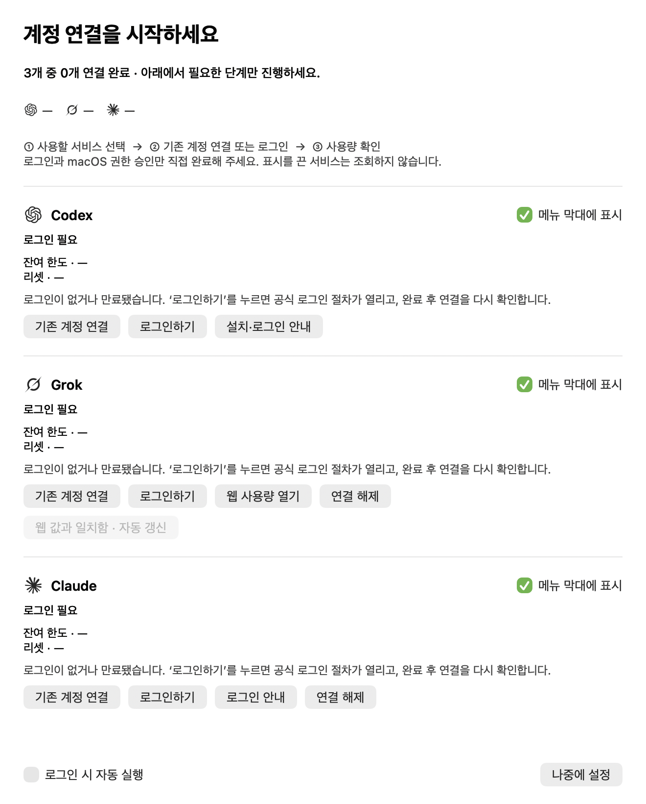
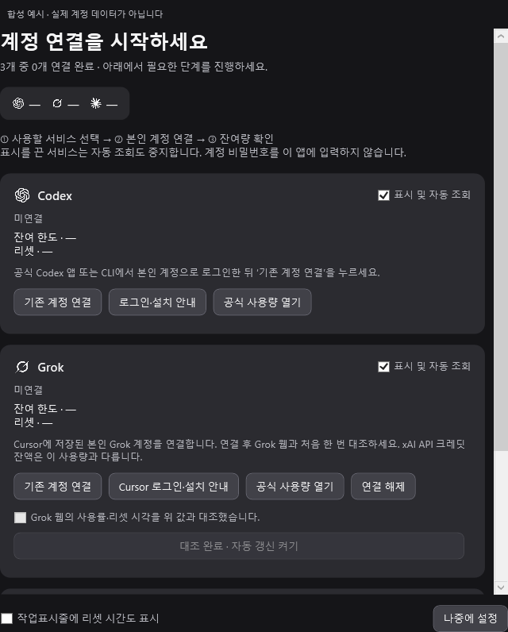
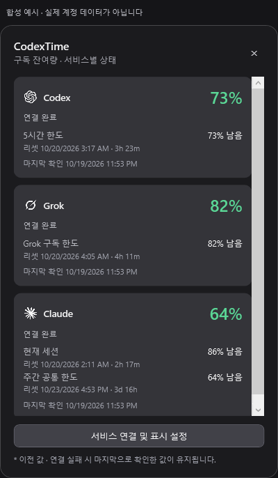
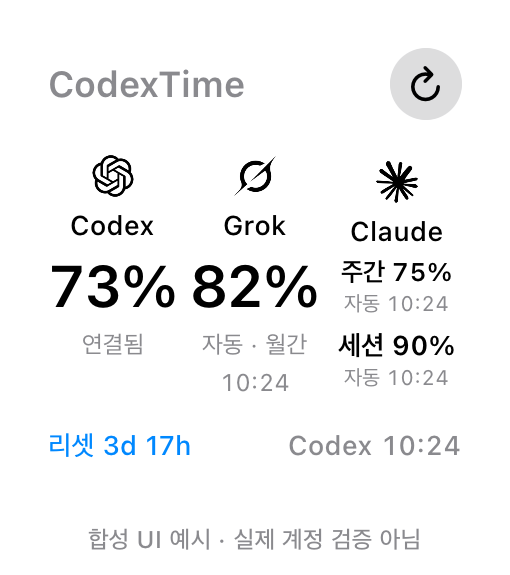

# CodexTime

**AI 구독 사용량과 리셋 시간을 한눈에.**

[](https://github.com/sundaynighttt/codextime/actions/workflows/ci.yml)
[](https://github.com/sundaynighttt/codextime/releases/latest)
[](LICENSE)

> [!NOTE]
> **새 소식 · iPhone 1.0(17) TestFlight · Windows 0.4.0 세 서비스 미리보기 · macOS v0.3.1**
>
> **v0.3.0부터 macOS에서 Codex · Grok · Claude를 함께 표시합니다.**
> 이번 v0.3.1에는 **간편 설정·공식 로그인·연결 완료 확인**을 추가했습니다. 사용할 서비스를 고르고 **로그인하기**로 공식 로그인을 시작한 뒤 연결 상태를 확인할 수 있습니다.
>
> macOS의 Grok은 Cursor 로그인과 웹 사용량 대조가 필요한 조건부 연결입니다. **iPhone 1.0(17)은 Codex·Grok 직접 조회와 Claude 비공식 호환 연결**을 제공합니다. Mac·PC·iCloud 없이 각 계정을 연결하며, 실제 계정 권한·숫자 대조는 별도 확인 대상입니다. **Windows 0.4.0 미리보기도 세 서비스 표시·계정 연결·서비스별 숨김을 지원합니다.** Windows 네이티브 검사·패키지 검증을 통과한 ZIP을 공개했으며, 실물 Windows 실계정 대조는 아직 남아 있습니다.
>
> **[macOS 설치 파일](https://github.com/sundaynighttt/codextime/releases/download/v0.3.1/CodexTime-macOS-0.3.1.dmg)** · **[Windows 0.4.0 설치 파일](https://github.com/sundaynighttt/codextime/releases/download/windows-v0.4.0/CodexTime-Windows-0.4.0.zip)** · [처음 설치·계정 연결하기](docs/macos-setup.md) · [전체 변경 내용](docs/releases/2026-10-19-v0.3.1.md)

**iPhone 1.0(17) TestFlight**는 Mac·PC·중계 서버 없이 Grok 직접 인증·조회와 Claude 비공식 호환 연결을 구현했습니다. 앱 활성화·복귀·10분 갱신과 위젯 직접 조회를 통합했으며 합성 테스트 170개를 통과했습니다. Apple 처리 완료와 내부 테스트 그룹 배정을 확인했습니다. 실계정 권한·숫자·인증 갱신 대조는 아직 미확인입니다. Claude는 공급자의 타사 구독 OAuth 제한이 있으므로 공식 승인·안정 지원으로 소개하지 않습니다. [후보 동작·검증과 제한](docs/releases/2026-10-20-ios-direct-refresh.md)

서비스마다 남은 사용량과 리셋 시간을 따로 확인하는 게 불편해서 만들었습니다.

CodexTime은 지원하는 AI 서비스의 남은 사용량과 리셋까지 남은 시간을 짧게 보여주는 무료 오픈소스 앱입니다.

- **macOS — Codex · Grok · Claude:** 기본 표시와 서비스별 숨김·조회 중지 선택, 필요하면 리셋 시간도 함께 표시
- **Windows — Codex · Grok · Claude:** 0.4.0 공개 미리보기. 세 로고·독립 잔여율, 서비스별 숨김·조회 중지, 계정 연결과 선택적 리셋 시간
- **iPhone — Codex · Grok · Claude:** TestFlight1.0(17)의 3열 카드·소형 위젯. Codex·Grok 직접 조회와 Claude 비공식 호환 연결·세션/주간 표시. 각 계정별 지원 확인 필요
- Windows에서는 우상단 미니 위젯으로 전환 가능
- 별도 OpenAI API 키 불필요
- 광고·분석·텔레메트리 없음

> CodexTime은 서비스 제공자의 공식 제품이 아닌 커뮤니티 프로젝트입니다. Codex CLI·계정 사용량 인터페이스와 운영체제별 공급자 연결을 사용하며, 외부 서비스 변경에 따라 수정이 필요할 수 있습니다.

<details>
<summary>릴리스 기준과 전체 버전 흐름 펼치기</summary>

<!-- project-release-ledger:start -->
## 릴리스 기준과 전체 버전 흐름

> 자동 관리 원장: [`docs/releases/release-ledger.json`](docs/releases/release-ledger.json) · 갱신일: `2026-10-20`

### 현재 기준선

| 기준 | 버전 | 단계 | 상태 | 요약 | 근거 |
| --- | --- | --- | --- | --- | --- |
| iPhone 최신 후보<br>`latest_candidate` | **`1.0 (17)`** | `external_processed` | `passed` | 아이폰 단독 Grok 직접 조회·Claude 비공식 PKCE 호환 연결;170 XCTest·Release/배포서명·최종3플랫폼CI통과,13:21:13 KST업로드·Apple처리/내부그룹배정확인,실계정/Claude허용미확인 | [project.yml](ios/project.yml)<br>[2026-10-20-ios-direct-refresh.md](docs/releases/2026-10-20-ios-direct-refresh.md)<br>[submission.md](docs/app-store/submission.md)<br>`git:40d2f2e`<br>`git:9f5dcb6`<br>[외부 근거](https://github.com/sundaynighttt/codextime/actions/runs/39368369324)<br>[외부 근거](https://github.com/sundaynighttt/codextime/pull/20)<br>[외부 근거](https://appstoreconnect.apple.com/apps/6805935440/testflight/ios/4ac35106-3be9-4b90-9fd2-8f1df6625f59)<br>[외부 근거](https://testflight.apple.com/v1/app/6805935440) |
| Apple 처리 확인 최신<br>`last_external` | **`1.0 (17)`** | `external_processed` | `passed` | 아이폰 단독 Grok 직접 조회·Claude 비공식 PKCE 호환 연결;170 XCTest·Release/배포서명·최종3플랫폼CI통과,13:21:13 KST업로드·Apple처리/내부그룹배정확인,실계정/Claude허용미확인 | [project.yml](ios/project.yml)<br>[2026-10-20-ios-direct-refresh.md](docs/releases/2026-10-20-ios-direct-refresh.md)<br>[submission.md](docs/app-store/submission.md)<br>`git:40d2f2e`<br>`git:9f5dcb6`<br>[외부 근거](https://github.com/sundaynighttt/codextime/actions/runs/39368369324)<br>[외부 근거](https://github.com/sundaynighttt/codextime/pull/20)<br>[외부 근거](https://appstoreconnect.apple.com/apps/6805935440/testflight/ios/4ac35106-3be9-4b90-9fd2-8f1df6625f59)<br>[외부 근거](https://testflight.apple.com/v1/app/6805935440) |
| macOS 공개 최신<br>`latest_desktop_release` | **`0.3.1 (2026101907)`** | `released` | `active` | macOS 간편 설정·공식 로그인·자동 연결 확인 공개; 109 tests·전체 CI·서명·공증 universal DMG·비로그인 다운로드 및 체크섬 검증 통과 | [2026-10-19-v0.3.1.md](docs/releases/2026-10-19-v0.3.1.md)<br>[macos-setup.md](docs/macos-setup.md)<br>[build-macos.sh](macos/scripts/build-macos.sh)<br>[release.yml](.github/workflows/release.yml)<br>[외부 근거](https://github.com/sundaynighttt/codextime/actions/runs/39216253992)<br>[외부 근거](https://github.com/sundaynighttt/codextime/releases/tag/v0.3.1)<br>[외부 근거](https://github.com/sundaynighttt/codextime/actions/runs/39216176410) |
| macOS 로컬 설치·실행 확인<br>`last_installed_smoke` | **`0.3.1 (2026101907)`** | `released` | `active` | macOS 간편 설정·공식 로그인·자동 연결 확인 공개; 109 tests·전체 CI·서명·공증 universal DMG·비로그인 다운로드 및 체크섬 검증 통과 | [2026-10-19-v0.3.1.md](docs/releases/2026-10-19-v0.3.1.md)<br>[macos-setup.md](docs/macos-setup.md)<br>[build-macos.sh](macos/scripts/build-macos.sh)<br>[release.yml](.github/workflows/release.yml)<br>[외부 근거](https://github.com/sundaynighttt/codextime/actions/runs/39216253992)<br>[외부 근거](https://github.com/sundaynighttt/codextime/releases/tag/v0.3.1)<br>[외부 근거](https://github.com/sundaynighttt/codextime/actions/runs/39216176410) |
| Windows 공개 미리보기 최신<br>`latest_windows_release` | **`windows-v0.4.0`** | `released` | `active` | Windows 0.4.0 세 서비스 공개 미리보기; 네이티브·전송·저장소·상태관리7시나리오·UI·패키지 재실행·WPF PNG4종·전체 CI·비로그인 다운로드/SHA256 통과, 실물 계정 대조 미검증 | [CodexTime.Windows.csproj](windows/CodexTime.Windows/CodexTime.Windows.csproj)<br>[2026-10-20-windows-v0.4.0.md](docs/releases/2026-10-20-windows-v0.4.0.md)<br>[windows-setup.md](docs/windows-setup.md)<br>`git:5e026a0`<br>[외부 근거](https://github.com/sundaynighttt/codextime/actions/runs/39344190966)<br>[외부 근거](https://github.com/sundaynighttt/codextime/releases/tag/windows-v0.4.0) |

### 전체 버전 흐름

| 순서 | 날짜 | 버전 | 단계 | 상태 | 요약 | 근거 |
| ---: | --- | --- | --- | --- | --- | --- |
| 1 | 2026-08-26 | `v0.1.0` | `released` | `historical` | 최초 macOS 공개 배포 | `git:v0.1.0`<br>[외부 근거](https://github.com/sundaynighttt/codextime/releases/tag/v0.1.0) |
| 2 | 2026-08-26 | `v0.1.1` | `released` | `historical` | macOS 서명·공증 공개본 | `git:v0.1.1`<br>[외부 근거](https://github.com/sundaynighttt/codextime/releases/tag/v0.1.1) |
| 3 | 2026-08-26 | `windows-v0.2.0` | `released` | `historical` | Windows 상시 표시 WPF 사전 배포 | `git:windows-v0.2.0`<br>[외부 근거](https://github.com/sundaynighttt/codextime/releases/tag/windows-v0.2.0) |
| 4 | 2026-08-26 | `v0.2.0` | `released` | `historical` | 한국어 중심 공개 안내 및 데스크톱 배포 | `git:v0.2.0`<br>[외부 근거](https://github.com/sundaynighttt/codextime/releases/tag/v0.2.0) |
| 5 | 2026-08-26 | `v0.2.1` | `released` | `historical` | 설치 앱 아이콘 추가 | `git:v0.2.1`<br>[외부 근거](https://github.com/sundaynighttt/codextime/releases/tag/v0.2.1) |
| 6 | 2026-08-26 | `v0.2.2` | `released` | `historical` | 간결한 사용량 표시 설정 | `git:v0.2.2`<br>[외부 근거](https://github.com/sundaynighttt/codextime/releases/tag/v0.2.2) |
| 7 | 2026-08-26 | `v0.2.3` | `released` | `historical` | macOS 메뉴바 표시 복구 | `git:v0.2.3`<br>[외부 근거](https://github.com/sundaynighttt/codextime/releases/tag/v0.2.3) |
| 8 | 2026-08-28 | `0.3.0 (1)` | `external_processed` | `historical` | 최초 iPhone 전용·암호화 설정 및 내부 전용 테스트; 2026-09-04 ASC 처리 상태 확인, 설치 수만으로 smoke 통과를 추정하지 않음 | `git:4a58f5a`<br>[submission.md](docs/app-store/submission.md) |
| 9 | 2026-08-28 | `0.3.0 (2)` | `external_processed` | `historical` | 일반 TestFlight 업로드 빌드; 2026-09-04 ASC 처리 상태 확인, 설치 수만으로 smoke 통과를 추정하지 않음 | `git:24be6f8`<br>[submission.md](docs/app-store/submission.md) |
| 10 | 2026-08-28 | `0.3.0 (3)` | `external_processed` | `historical` | 기기 로그인 대기 유지; 2026-09-04 ASC 처리 상태 확인, 설치 수만으로 smoke 통과를 추정하지 않음 | `git:eb80e99`<br>[submission.md](docs/app-store/submission.md) |
| 11 | 2026-08-28 | `0.3.0 (4)` | `external_processed` | `historical` | 위젯 새로고침 버튼; 2026-09-04 ASC 처리 상태 확인, 설치 수만으로 smoke 통과를 추정하지 않음 | `git:13a95d9`<br>[submission.md](docs/app-store/submission.md) |
| 12 | 2026-08-28 | `0.3.0 (5)` | `external_processed` | `historical` | 위젯 갱신 시각 표시; 2026-09-04 ASC 처리 상태 확인, 설치 수만으로 smoke 통과를 추정하지 않음 | `git:cd2139c`<br>[submission.md](docs/app-store/submission.md) |
| 13 | 2026-08-30 | `0.3.0 (6)` | `external_processed` | `historical` | 위젯 누적 토큰 표시; 2026-09-04 ASC 처리 상태 확인, 설치 수만으로 smoke 통과를 추정하지 않음 | `git:df50a6e`<br>[submission.md](docs/app-store/submission.md) |
| 14 | 2026-09-03 | `0.3.0 (7)` | `external_processed` | `historical` | 위젯 새로고침 버튼 정렬; 2026-09-04 ASC 처리 상태 확인, 설치 수만으로 smoke 통과를 추정하지 않음 | `git:d9f37ad`<br>[submission.md](docs/app-store/submission.md) |
| 15 | 2026-09-03 | `0.3.0 (8)` | `external_processed` | `historical` | 위젯 갱신 시각을 제목 오른쪽 괄호로 이동; 2026-09-04 ASC 처리 상태 확인, 설치 수만으로 smoke 통과를 추정하지 않음 | `git:df03b4d`<br>[submission.md](docs/app-store/submission.md) |
| 16 | 2026-09-04 | `1.0 (9)` | `external_processed` | `historical` | 2026-09-04 당시 예시 모드·14 tests·업로드 처리·App Store 심사 제출 확인 이력; 2026-10-19 현재 심사 대기로 단정하지 않음 | [project.yml](ios/project.yml)<br>[submission.md](docs/app-store/submission.md) |
| 17 | 2026-10-19 | `0.2.4 (2026101901)` | `installed_smoke` | `historical` | macOS 세 로고·독립 상태 처리 로컬 설치·실행 및 42 tests/Codex 실조회 통과; Grok Bot·Claude quota 미연결, 실제 메뉴 클릭 검수는 Computer Use timeout으로 미완료 | [2026-10-19-macos-local.md](docs/releases/2026-10-19-macos-local.md)<br>[protocol.md](docs/protocol.md)<br>[build-macos.sh](macos/scripts/build-macos.sh) |
| 18 | 2026-10-19 | `0.2.4 (2026101902)` | `installed_smoke` | `historical` | 승인된 Grok Bot·Claude 연결 구현·설치 및 75 tests; Codex·Claude 실제 조회 성공, Grok 인증 필요 | [2026-10-19-macos-local.md](docs/releases/2026-10-19-macos-local.md)<br>[protocol.md](docs/protocol.md)<br>[build-macos.sh](macos/scripts/build-macos.sh) |
| 19 | 2026-10-19 | `0.2.4 (2026101903)` | `installed_smoke` | `historical` | Grok 고정 인증 단계 진단·설치 및 78 tests; Codex·Claude 실제 조회 성공, Grok 지정 Keychain 항목 부재로 HTTP 전 중단, 메뉴 육안 검수는 Computer Use timeout으로 미완료 | [2026-10-19-macos-local.md](docs/releases/2026-10-19-macos-local.md)<br>[protocol.md](docs/protocol.md)<br>[build-macos.sh](macos/scripts/build-macos.sh) |
| 20 | 2026-10-19 | `0.2.4 (2026101904)` | `installed_smoke` | `historical` | 일반 Grok 구독으로 전환 준비·Bot 조회 중단; 79 tests 및 설치본 Codex·Claude 실조회 통과, 일반 Grok 새 인증 연결 승인 대기 | [2026-10-19-macos-local.md](docs/releases/2026-10-19-macos-local.md)<br>[protocol.md](docs/protocol.md)<br>[build-macos.sh](macos/scripts/build-macos.sh) |
| 21 | 2026-10-19 | `0.2.4 (2026101905)` | `installed_smoke` | `historical` | 승인된 Cursor 단일 키로 Grok 공유 quota 연결·웹 표시 정밀도 및 reset 대조 후 10분 갱신 활성화; 90 tests·설치·서명·세 로고 실제 검수 창 readback 통과 | [2026-10-19-macos-local.md](docs/releases/2026-10-19-macos-local.md)<br>[protocol.md](docs/protocol.md)<br>[CursorGrokCredentialSource.swift](macos/Sources/CodexUsageMonitor/CursorGrokCredentialSource.swift)<br>[build-macos.sh](macos/scripts/build-macos.sh) |
| 22 | 2026-10-19 | `0.3.0 (2026101906)` | `released` | `historical` | macOS 세 서비스 표시·조회 선택과 본인 계정 설정 공개; 99 tests·전체 CI·서명·공증 universal DMG·비로그인 다운로드 및 체크섬 검증 통과 | [2026-10-19-v0.3.0.md](docs/releases/2026-10-19-v0.3.0.md)<br>[macos-setup.md](docs/macos-setup.md)<br>[build-macos.sh](macos/scripts/build-macos.sh)<br>[release.yml](.github/workflows/release.yml)<br>[외부 근거](https://github.com/sundaynighttt/codextime/actions/runs/39195054137)<br>[외부 근거](https://github.com/sundaynighttt/codextime/releases/tag/v0.3.0)<br>[외부 근거](https://github.com/sundaynighttt/codextime/actions/runs/39195689279) |
| 23 | 2026-10-19 | `1.0 (10)` | `external_processed` | `historical` | Codex 전용 iPhone 앱·위젯, 14 tests·서명 검증·13:02 KST 업로드 및 13:04 KST Apple 테스트 가능 알림 확인; 그룹 배포·실기기 설치 미확인 | [project.yml](ios/project.yml)<br>[2026-10-19-ios-testflight.md](docs/releases/2026-10-19-ios-testflight.md)<br>[submission.md](docs/app-store/submission.md) |
| 24 | 2026-10-19 | `1.0 (11)` | `external_processed` | `historical` | 3열 카드·Codex 직접 조회·17 tests 및 업로드/Apple 처리 확인; ASC CodexTime Internal 1명·빌드11 설치 표시1 확인, 실제 기능 smoke는 별도 미확인 | [project.yml](ios/project.yml)<br>[2026-10-19-ios-three-provider-card.md](docs/releases/2026-10-19-ios-three-provider-card.md)<br>[submission.md](docs/app-store/submission.md) |
| 25 | 2026-10-19 | `0.3.1 (2026101907)` | `released` | `active` | macOS 간편 설정·공식 로그인·자동 연결 확인 공개; 109 tests·전체 CI·서명·공증 universal DMG·비로그인 다운로드 및 체크섬 검증 통과 | [2026-10-19-v0.3.1.md](docs/releases/2026-10-19-v0.3.1.md)<br>[macos-setup.md](docs/macos-setup.md)<br>[build-macos.sh](macos/scripts/build-macos.sh)<br>[release.yml](.github/workflows/release.yml)<br>[외부 근거](https://github.com/sundaynighttt/codextime/actions/runs/39216253992)<br>[외부 근거](https://github.com/sundaynighttt/codextime/releases/tag/v0.3.1)<br>[외부 근거](https://github.com/sundaynighttt/codextime/actions/runs/39216176410) |
| 26 | 2026-10-19 | `iCloud 동기화 실험` | `abandoned` | `abandoned` | 별도 브랜치에서 macOS 0.3.1(2026101907)을 재사용한 중단·미배포 iCloud 후보; Mac102/shared20 tests·ad-hoc 패키징 통과, Developer ID export 프로비저닝 대기 후 종료, 공개 v0.3.1과 다른 산출물이며 정식 서명 배포·설치·실제 전송 없음 | [2026-10-19-private-icloud-sync.md](docs/releases/2026-10-19-private-icloud-sync.md)<br>`git:f98bb6d`<br>`git:bdef8de` |
| 27 | 2026-10-19 | `1.0 (12)` | `failed` | `historical` | 중단·미업로드 iCloud 후보:24 tests·시뮬레이터 통과, 앱/위젯 CloudKit 프로필 불일치로 두 Release archive 실패; TestFlight·실제 동기화 없음 | [2026-10-19-private-icloud-sync.md](docs/releases/2026-10-19-private-icloud-sync.md)<br>`git:f98bb6d`<br>`git:bdef8de` |
| 28 | 2026-10-19 | `1.0 (13)` | `external_processed` | `historical` | iPhone 웹 수동 사용량·42 XCTest/96 Node cases·Release UI/서명 통과; 21:13업로드·약21:18 Apple 처리와Internal1명배정 확인, 실계정 검증은 사용자 TestFlight 예정 | [project.yml](ios/project.yml)<br>[2026-10-19-ios-web-usage.md](docs/releases/2026-10-19-ios-web-usage.md)<br>[submission.md](docs/app-store/submission.md)<br>`git:bdb1bb6`<br>`git:6943976`<br>[외부 근거](https://appstoreconnect.apple.com/teams/8874948e-3fee-4bea-a414-67a4c0f0e7d8/apps/6805935440/testflight/ios/4e556a52-67f9-4190-a95a-09dca4272252) |
| 29 | 2026-10-19 | `1.0 (14)` | `external_processed` | `historical` | 웹 로그인 영역 확대·조작 패널 접기·키보드 대응; iPhone17e 빈 폼·42 XCTest·Release 서명, 21:39업로드·21:42~43 Apple 처리/Internal1명·21:44안내 저장 확인 | [project.yml](ios/project.yml)<br>[2026-10-19-ios-web-height.md](docs/releases/2026-10-19-ios-web-height.md)<br>[submission.md](docs/app-store/submission.md)<br>`git:da7d762`<br>[외부 근거](https://appstoreconnect.apple.com/teams/8874948e-3fee-4bea-a414-67a4c0f0e7d8/apps/6805935440/testflight/ios/9b6de1a7-c183-4198-a084-9dfe9be7182a) |
| 30 | 2026-10-19 | `1.0 (15)` | `external_processed` | `historical` | Claude 새창 제한 안내·화면 복귀·51 XCTest·Release 서명 통과; 22:38:48 KST 업로드·22:41:37 Apple 테스트 가능 알림 확인, Google OAuth 미지원·실계정 검증 대기 | [project.yml](ios/project.yml)<br>[2026-10-19-claude-login-recovery.md](docs/releases/2026-10-19-claude-login-recovery.md)<br>[submission.md](docs/app-store/submission.md)<br>`git:48015b5`<br>[외부 근거](https://testflight.apple.com/v1/app/6805935440) |
| 31 | 2026-10-19 | `1.0 (16)` | `external_processed` | `passed` | Claude 세션·공통주간 한 번 읽기·한도별 앱/위젯 표시; 80 XCTest·Release·서명, 23:40:44 업로드·23:43:46 KST Apple 테스트 가능 확인, iPhone 실계정 대조 대기 | [project.yml](ios/project.yml)<br>[2026-10-19-claude-usage-reader.md](docs/releases/2026-10-19-claude-usage-reader.md)<br>[submission.md](docs/app-store/submission.md)<br>`git:9cd429d`<br>`git:0effad7`<br>[외부 근거](https://testflight.apple.com/v1/app/6805935440) |
| 32 | 2026-10-20 | `windows-v0.4.0` | `released` | `active` | Windows 0.4.0 세 서비스 공개 미리보기; 네이티브·전송·저장소·상태관리7시나리오·UI·패키지 재실행·WPF PNG4종·전체 CI·비로그인 다운로드/SHA256 통과, 실물 계정 대조 미검증 | [CodexTime.Windows.csproj](windows/CodexTime.Windows/CodexTime.Windows.csproj)<br>[2026-10-20-windows-v0.4.0.md](docs/releases/2026-10-20-windows-v0.4.0.md)<br>[windows-setup.md](docs/windows-setup.md)<br>`git:5e026a0`<br>[외부 근거](https://github.com/sundaynighttt/codextime/actions/runs/39344190966)<br>[외부 근거](https://github.com/sundaynighttt/codextime/releases/tag/windows-v0.4.0) |
| 33 | 2026-10-20 | `1.0 (17)` | `external_processed` | `passed` | 아이폰 단독 Grok 직접 조회·Claude 비공식 PKCE 호환 연결;170 XCTest·Release/배포서명·최종3플랫폼CI통과,13:21:13 KST업로드·Apple처리/내부그룹배정확인,실계정/Claude허용미확인 | [project.yml](ios/project.yml)<br>[2026-10-20-ios-direct-refresh.md](docs/releases/2026-10-20-ios-direct-refresh.md)<br>[submission.md](docs/app-store/submission.md)<br>`git:40d2f2e`<br>`git:9f5dcb6`<br>[외부 근거](https://github.com/sundaynighttt/codextime/actions/runs/39368369324)<br>[외부 근거](https://github.com/sundaynighttt/codextime/pull/20)<br>[외부 근거](https://appstoreconnect.apple.com/apps/6805935440/testflight/ios/4ac35106-3be9-4b90-9fd2-8f1df6625f59)<br>[외부 근거](https://testflight.apple.com/v1/app/6805935440) |
<!-- project-release-ledger:end -->

</details>

## 화면

macOS **v0.3.1 (2026101907)** — Codex · Grok · Claude 기본 메뉴바:


<details>
<summary>macOS v0.3.1 간편 설정 화면 — 로그인 전</summary>



</details>

Windows **0.4.0 공개 미리보기** — 실제 WPF 화면에 합성 예시를 넣어 렌더링한 세 서비스 표시:


<details>
<summary>Windows 간편 설정과 세 서비스 상세 화면</summary>




</details>

iPhone **1.0 (17) · TestFlight 호환 연결** — 실제 소형 위젯 뷰에 합성 값을 넣은 미리보기:



실제 계정 수치가 아닌 문서용 합성 예시입니다. [빌드17 소스](https://github.com/sundaynighttt/codextime/tree/5f8851900aa27ae1586fbb6ee0f5f96f35ece8e0)의 실제 위젯 뷰를 iOS Simulator에서 렌더링했으며 Claude 연결 허용·실계정 호환성을 입증하지 않습니다. 기존 [빌드16 TestFlight 이미지](docs/screenshots/ios-widget-v1.0-b16.png)는 보존했습니다. 실제 앱의 오프라인 예시 모드는 Grok·Claude 샘플 숫자를 만들지 않습니다. [이미지 기준과 다시 생성하는 방법](docs/screenshots/README.md)

## 다운로드

macOS 안정판은 **[v0.3.1](https://github.com/sundaynighttt/codextime/releases/tag/v0.3.1)**, 세 서비스를 추가한 Windows 공개 미리보기는 **[0.4.0](https://github.com/sundaynighttt/codextime/releases/tag/windows-v0.4.0)**입니다. [Windows 설치·연결 안내](docs/windows-setup.md) · [변경·검증 상태](docs/releases/2026-10-20-windows-v0.4.0.md)

**macOS v0.3.1 (2026101907)을 공개했습니다.** macOS 13 이상, Intel·Apple Silicon Universal 앱이며 Developer ID 서명과 앱·DMG Apple 공증을 완료했습니다. 비로그인 다운로드와 체크섬·Gatekeeper 검증도 확인했습니다.

| 운영체제 | 설치 파일 | 사용량 연결 |
| --- | --- | --- |
| macOS | [CodexTime-macOS-0.3.1.dmg](https://github.com/sundaynighttt/codextime/releases/download/v0.3.1/CodexTime-macOS-0.3.1.dmg) | Codex·Claude, 조건을 확인한 Cursor 기반 Grok 연결 |
| Windows 0.4.0 미리보기 | [CodexTime-Windows-0.4.0.zip](https://github.com/sundaynighttt/codextime/releases/download/windows-v0.4.0/CodexTime-Windows-0.4.0.zip) | Codex·Claude, 웹 대조가 필요한 Cursor 기반 Grok. Windows 10/11 x64 |

각 사용자가 자신의 Mac·PC에서 본인 계정으로 로그인해야 합니다. 배포 파일에 개발자의 인증정보나 계정 캐시가 들어 있지 않습니다. macOS Codex 연결은 설치된 ChatGPT/Codex 앱의 지원되는 내장 CLI 또는 [공식 Codex CLI](https://github.com/openai/codex#installation)를 사용하며, 다른 서비스는 각각 별도로 연결합니다. [macOS 설치·계정 연결 안내](docs/macos-setup.md)를 참고하세요.

iPhone 최신 TestFlight는 **1.0(17)**입니다. Apple 처리 완료와 **CodexTime Internal** 그룹 배정을 확인했습니다. 기존 테스터는 [TestFlight](https://testflight.apple.com/v1/app/6805935440)에서 업데이트한 뒤 각 계정을 연결합니다. iOS17 이상 iPhone에서 Mac·PC·Cursor·iCloud·별도 API 키 없이 직접 조회를 시도합니다. Grok은 기기 승인, Claude는 공식 타사 허용이 확인되지 않은 비공식 PKCE 호환 방식이며 실제 계정의 사용량 권한·공식 웹 수치·인증 갱신 대조는 미검증입니다. 기존 수동 웹 확인도 유지합니다. 소스·이미지·빌드 설정이17을 가리키며 App Store 정식 출시는 수행하지 않았습니다. [iPhone 연결 안내](ios/README.md) · [빌드17 동작·검증](docs/releases/2026-10-20-ios-direct-refresh.md) · [제출 현황](docs/app-store/submission.md)

## macOS 설치와 간편 설정

**v0.3.1부터 앱 안에서 로그인과 연결 확인을 진행할 수 있습니다.** 필요한 공식 앱·CLI가 없으면 공식 설치 안내를 엽니다.

1. DMG를 열어 **Codex Usage Monitor**를 **Applications**로 옮기고 실행합니다.
2. **CodexTime 간편 설정**에서 사용할 서비스를 선택합니다. 이미 로그인했다면 **기존 계정 연결**, 처음이거나 로그인이 만료됐다면 **로그인하기**를 누릅니다.
3. Codex·Claude는 공식 브라우저 로그인이 완료되면 사용량 연결을 자동 확인합니다. 최초 연결의 조회 동의와 macOS Keychain 권한 승인은 본인이 완료합니다.
4. Grok은 열린 Cursor의 **General → Sign In**에서 같은 계정으로 로그인한 뒤 설정 창으로 돌아옵니다. **웹 사용량 열기**에서 사용률·리셋을 대조하고 일치할 때 자동 갱신을 시작합니다.
5. **설정 완료**를 누릅니다. 필요하면 **로그인 시 자동 실행**도 선택하세요. 이후 연결된 서비스는 **10분마다** 갱신됩니다.

[설치·업데이트·서비스별 로그인과 문제 해결 안내](docs/macos-setup.md) · [v0.3.1 변경 및 검증](docs/releases/2026-10-19-v0.3.1.md)

표시 선택을 끄면 해당 서비스의 표시와 조회가 멈춥니다. 모두 꺼도 복구용 **사용량** 메뉴가 남습니다. `—`는 미연결·미확인, `*`는 이전 성공 값입니다. 연결 설정은 다음 실행에도 유지되며, 계정 변경은 Claude·Grok의 **연결 해제** 후 진행합니다. 언제든 메뉴의 **간편 설정 및 계정 연결…**에서 다시 설정할 수 있습니다.

## iPhone 연결

1. **Codex:** 앱의 **ChatGPT 연결**에서 본인의 기기 로그인을 완료합니다.
2. **Grok:** **Grok 연결**에서 연결을 시작하고 공식 xAI 승인 페이지에서 코드를 승인한 뒤 돌아옵니다. 공유 인증 방식이라 승인 화면에 **Grok Build**가 표시될 수 있습니다. 실제 계정의 billing 권한과 공식 웹의 값·리셋이 일치하는지 확인해야 합니다.
3. **Claude:** **Claude 연결 → 호환 방식으로 연결**은 공급자의 타사 구독 OAuth 제한이 있는 비공식 후보입니다. 안내를 확인하고 연결을 선택하면 공식 승인 페이지를 열고 인증 결과 전체(`code#state`)를 앱에 직접 붙여넣습니다. 로그인 결과를 채팅·이슈에 보내지 마세요. CodexTime의 사용 허용·계정 호환성은 확인되지 않았습니다.
4. 성공한 직접 연결은 앱 활성 중 약10분마다, 다시 열 때 오래된 값을 조회합니다. 위젯은 iOS가 허용하는 시점에 직접 조회하며 정확한 백그라운드 간격은 보장하지 않습니다. 실제 조회 시각·지난 조회·재연결 필요를 구분합니다.
5. 기존 **웹에서 직접 확인**은 별도 수동 대안입니다. 직접 연결을 시작하면 이전 웹 기록을 초기화하며, 다른 계정의 수치와 섞지 않습니다. 연결 해제는 이 앱의 해당 토큰·기록을 지웁니다.

실제 계정 확인은 TestFlight에서 진행합니다. [상세 연결·공식 허용 제약·기록 삭제 안내](ios/README.md)

## Windows 설치

**0.4.0 공개 미리보기**는 Mac과 같은 세 서비스 표시·연결 흐름을 제공합니다. 세 로고는 기본으로 모두 보이며, 숨긴 서비스는 조회도 중지합니다. Windows CI의 네이티브 빌드·전송·저장소·상태관리·UI·패키지 실행 검증과 비로그인 다운로드·체크섬 대조를 통과했습니다. 실물 Windows 실계정 대조는 아직 남아 있습니다.

위 표의 Windows 0.4.0 ZIP을 내려받아 설치합니다.

1. ZIP 파일의 압축을 풉니다.
2. 해당 폴더에서 PowerShell을 엽니다.
3. 다음 명령을 실행합니다.

```powershell
powershell -ExecutionPolicy Bypass -File .\install.ps1 -EnableStartup
```

0.4.0은 첫 실행의 계정 설정에서 Codex·Claude 공식 CLI 로그인 또는 Cursor 로그인을 시작합니다. Claude·Grok은 사용량 조회 동의를 별도로 받고, Grok은 본인 웹 사용률·리셋과 대조한 뒤 자동 갱신을 켭니다. 기본 10분 갱신과 공급자별 오류·이전 값 표시를 사용하며 리셋 시간은 선택해서 켭니다.

기본 화면은 오른쪽 알림 영역 옆의 작은 사용량 표시입니다. 클릭하면 상세 사용량을 보고, 오른쪽 클릭 메뉴에서 계정 설정·서비스별 표시·새로고침·우상단 미니 위젯·자동 실행·종료를 선택합니다. [서비스별 연결·지원하지 않는 저장소·문제 해결](docs/windows-setup.md)

Windows 실행 파일과 설치 스크립트는 아직 코드 서명되지 않았습니다. 필요한 경우 공개된 소스를 확인하고 릴리스의 [`SHA256SUMS-Windows.txt`](https://github.com/sundaynighttt/codextime/releases/download/windows-v0.4.0/SHA256SUMS-Windows.txt)로 파일 무결성을 검증하세요.

삭제하려면 CodexTime을 종료한 뒤 다음 명령을 실행합니다.

```powershell
powershell -ExecutionPolicy Bypass -File "$env:LOCALAPPDATA\CodexUsageMonitor\uninstall.ps1"
```

## 개인정보와 보안

- macOS와 Windows의 Codex 조회는 설치된 Codex CLI의 기존 로그인을 사용하며, `auth.json`이나 Codex 액세스 토큰을 직접 읽지 않습니다.
- macOS와 Windows 0.4.0의 Claude·Grok 인증정보 접근은 서비스별 앱 연결 동의 후 시작합니다. macOS Claude는 기본 Claude Code Keychain 항목, Windows Claude는 기본 `~/.claude/.credentials.json`의 OAuth access token을 사용합니다. Grok은 각 OS의 기본 Cursor 저장소에서 `cursorAuth/accessToken` 한 항목만 읽습니다. 토큰·실제 사용량은 앱 메모리에만 두며 배포 파일에 동봉하지 않습니다.
- Claude는 `api.anthropic.com`의 고정 usage 경로, Cursor 기반 Grok은 `api2.cursor.sh`의 고정 `GetSandUsageStatus` RPC만 호출합니다. Grok은 최초 웹 사용률·리셋 대조가 끝나기 전 자동 접근을 차단합니다. 이 내부 인터페이스의 지원 여부는 계정·구독과 서비스 변경에 따라 달라질 수 있습니다.
- 세 서비스 표시의 기본값은 켜짐이며, 숨긴 서비스는 자동·수동·잠자기 복귀 조회를 중지합니다. 연결된 표시 서비스만 기본 600초마다 갱신합니다. macOS 연결 해제는 앱 플래그와 메모리 캐시만 지우고 공식 앱·CLI의 원본 인증정보는 유지합니다.
- Windows Cursor 조회는 고정된 SQLite 런타임과 기존 DB·WAL·SHM의 읽기 전용 경로만 사용합니다. 지원하지 않는 저장 방식·파일 상태는 오류로 중단하고 다른 키·프로필·쿠키를 탐색하지 않습니다. [Windows 보관·읽기 범위](docs/windows-setup.md#인증정보와-보관-범위)를 참고하세요.
- macOS Claude의 OS 확인창은 명시적인 연결 요청에서만 허용하며 백그라운드 갱신은 확인창을 띄우지 않습니다. 로그인은 사용자가 앱에서 시작한 공식 CLI가 처리하며 앱은 인증 출력을 캡처하지 않습니다. 직접 토큰 갱신·원본 인증정보 수정·쿠키·대화 원문·다른 DB 항목 읽기를 하지 않고 비밀값·원시 응답·원시 오류를 로그에 남기지 않습니다.
- iPhone Codex와 TestFlight17의 Grok·Claude 직접 연결은 이 앱이 받은 인증 토큰을 동기화되지 않는 기기 전용 Keychain에 저장합니다. 다른 앱·CLI·브라우저의 인증정보를 읽지 않고, 공급자의 고정 인증·usage 경로에만 직접 요청합니다. Grok·Claude 수동 웹 로그인은 비영구 WebKit 세션을 사용하며 앱은 쿠키·토큰·입력 내용을 읽거나 내보내지 않습니다. 웹뷰의 숫자 읽기는 제한된 사용량 결과만 반환합니다.
- 개발자 자체 서버는 없습니다. 실제 계정 연결 시 해당 서비스 제공자에 인증·사용량 요청과 네트워크 정보가 직접 전달됩니다.
- iPhone의 웹 수동 확인 숫자·한도·확인 시각은 같은 기기의 App Group 캐시에만 보관합니다. 전체 웹 원문·인증정보는 저장하지 않고 자동 웹 갱신도 하지 않습니다. 예시 모드는 실제 웹 숫자와 분리합니다. 연결 해제·기록 삭제는 해당 서비스의 앱 세션과 캐시만 정리하며 외부 계정을 삭제하지 않습니다.
- 광고·사용자 분석·텔레메트리가 없습니다.
- 소스 코드와 빌드 과정이 모두 공개되어 있습니다.

인증 파일이나 토큰은 버그 제보에 첨부하지 마세요. [개인정보 처리방침](docs/privacy-policy.md)과 [SECURITY.md](SECURITY.md)를 참고하세요.

## 직접 빌드하고 확인하기

저장소를 내려받으면 전체 동작을 직접 확인하고 빌드할 수 있습니다.

macOS:

```bash
swift test --package-path macos
./macos/scripts/build-macos.sh
```

Windows(.NET 8 SDK 필요):

```powershell
powershell -ExecutionPolicy Bypass -File .\windows\test-parser.ps1
.\windows\package-windows.ps1 -Version 0.4.0
```

iPhone(Xcode와 XcodeGen 필요):

```bash
cd ios
xcodegen generate
xcodebuild -project CodexTime.xcodeproj -scheme CodexTime -sdk iphonesimulator build CODE_SIGNING_ALLOWED=NO
```

macOS와 Windows의 Codex 조회는 `codex app-server`를 짧게 실행해 `account/rateLimits/read` 결과만 읽습니다. iPhone은 기기 로그인 후 ChatGPT 사용량 엔드포인트에서 같은 메타데이터를 직접 읽습니다. 모두 사용한 비율을 남은 비율로 바꾸고, 리셋 시각을 남은 시간으로 표시합니다. 기본 한도 구간을 표시하며 모든 구간이나 API 결제 잔액을 표시하지는 않습니다. 자세한 필드와 통신 순서는 [docs/protocol.md](docs/protocol.md)에 정리되어 있습니다.

기여 방법은 [CONTRIBUTING.md](CONTRIBUTING.md), 전체 라이선스는 [MIT License](LICENSE)를 참고하세요.

## English

CodexTime is a free, open-source usage display for macOS, Windows, and iPhone. macOS stable is [v0.3.1](https://github.com/sundaynighttt/codextime/releases/tag/v0.3.1); the Windows three-provider public preview is [0.4.0](https://github.com/sundaynighttt/codextime/releases/tag/windows-v0.4.0). Native Windows tests, standalone packaging, synthetic UI rendering and anonymous download/checksum verification passed. Physical-Windows real-account checks remain outstanding. macOS displays Codex, Claude, and conditional Cursor-backed Grok usage with per-provider visibility controls. iPhone 1.0(17) has completed Apple processing and is assigned to the internal TestFlight group; existing testers can update through [TestFlight](https://testflight.apple.com/v1/app/6805935440). Its app and small widget show all three services. It adds standalone Grok device authorization and an unofficial Claude PKCE compatibility candidate, each using app-owned device-only credentials. No computer, iCloud relay, or developer server is needed. Connected providers refresh while the app is active and when iOS runs the widget; exact background timing is not guaranteed. Anthropic restricts third-party subscription OAuth use, and CodexTime permission and live-account compatibility remain unverified. Manual official-web readings remain a separate fallback. The Windows 0.4.0 preview adds independent Codex, Claude, and conditional Cursor-backed Grok states, visibility controls, account setup, and optional reset times. Claude uses its default Windows Claude Code credential after explicit app consent; Grok reads one Cursor token through a bounded read-only SQLite path and requires a web usage/reset comparison before automatic refresh. The older public Windows v0.3.1 ZIP remains Codex-only. See [Windows setup and limitations](docs/windows-setup.md). Real-account iPhone numeric/widget verification remains separate, and this is not a public App Store release. Users connect their own accounts; downloads contain no developer credentials, advertising, or analytics SDK.
