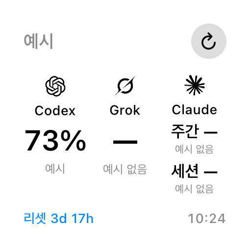

# CodexTime for iPhone

작은 카드와 소형 위젯에 **Codex / Grok / Claude**를 가로 3열로 표시합니다. **현재 소스의 1.0(17)은 아이폰 단독 직접 연결·자동 조회의 로컬 후보**입니다. Mac·PC·Cursor·iCloud·개발자 서버가 필요하지 않습니다. 기존 수동 웹 확인도 대체 경로로 유지합니다.

**Apple 처리 확인 최신은 1.0(16)**입니다. [기존 테스터용 TestFlight](https://testflight.apple.com/v1/app/6805935440)에서 업데이트할 수 있으나, 이 링크가 빌드17의 업로드·처리나 실제 계정 자동 갱신 완료를 의미하지는 않습니다. 후보의 실제 상태는 [릴리스 원장](../docs/releases/release-ledger.json)과 [제출 현황](../docs/app-store/submission.md)을 따릅니다.

## 1.0(17) 직접 연결 후보

- **Codex:** 기존 OpenAI 기기 로그인과 직접 사용량 조회를 유지합니다. 본인 ChatGPT 계정으로 연결하며 리셋·누적 토큰도 표시합니다.
- **Grok:** 앱에서 기기 인증을 시작하고 xAI 페이지에서 직접 승인하는 후보입니다. 공유 공개 OAuth 클라이언트 때문에 승인 화면에 **Grok Build**가 표시될 수 있습니다. 이 앱이 발급받은 토큰만 기기 전용 Keychain에 저장하고 직접 billing 사용률·기간·리셋을 조회합니다. 서버의 주간·월간·미상 기간을 구분합니다. 최소 요청 범위로 기기 코드를 받을 수 있음은 확인했지만 실제 계정의 usage 권한과 웹 숫자·리셋 대조는 아직 미검증입니다.
- **Claude:** 공개 네이티브 선례를 참고한 PKCE **비공식 호환 후보**입니다. 공식 페이지에서 승인한 뒤 같은 아이폰에서 일회성 인증 결과를 앱에 전달하는 방식을 구현합니다. 실제 계정 승인·`user:profile`의 usage 권한·토큰 갱신은 미검증입니다. **Anthropic이 CodexTime의 자체 앱 로그인을 허용했다고 확인한 경로가 아닙니다.** 활성 배포 여부도 별도 판단합니다.

Claude의 [공식 인증 지침](https://code.claude.com/docs/en/legal-and-compliance#authentication-and-credential-use)은 자체 앱의 Claude.ai 로그인 제공과 구독 자격증명·세션 토큰의 수집·보관·중개를 제한합니다. [공식 로그인 안내](https://support.claude.com/en/articles/13189465-log-in-to-your-claude-account)는 오픈소스를 포함한 타사 개발자에게 API 키 경로를 안내하며 특정 도구 허용은 Anthropic의 재량이라고 설명합니다. 사용량 전용·개인 오픈소스·내부 TestFlight 예외나 이 후보의 허용은 확인하지 못했습니다. 공개 사례나 합성 시험을 공급자 허가로 소개하지 않습니다.

직접 연결 후보는 다른 앱·CLI·브라우저의 쿠키·토큰을 가져오지 않습니다. 토큰은 같은 기기의 서명된 앱·위젯이 공유하는 `ThisDeviceOnly` Keychain, 숫자·기간·리셋·실제 관측 시각은 App Group에 분리 보관합니다. 메시지·모델 호출·대화 조회는 없습니다. [개인정보 처리방침](../docs/privacy-policy.md)과 [직접 연결 동작 계약](../docs/protocol.md)을 확인하세요.

## 갱신과 값의 출처

- 연결된 직접 공급자는 앱 활성화·복귀·새로고침과 활성 중 10분 주기로 각각 조회합니다. 한 공급자의 미연결·실패 때문에 다른 공급자가 멈추지 않도록 구현합니다.
- 위젯도 직접 조회를 시도하고 30분 뒤 타임라인 갱신을 요청합니다. **실제 실행 시점은 iOS가 결정**하므로 앱을 닫은 상태의 정확한 10분/30분 갱신은 보장하지 않습니다.
- 숫자가 없으면 `—`, 실제 잔여율이 영이면 `0%`입니다. 직접 조회와 수동 웹 확인은 한도·출처·실제 조회/확인 시각을 구분합니다. 직접 값은 20분 경과 또는 리셋 경과 뒤 지난 조회로 표시하고, 수동 값은 1시간 뒤 지난 확인으로 표시합니다.
- 같은 계정의 일시적인 실패는 마지막 성공 숫자·시각을 유지합니다. 로그인 만료·불확실한 토큰 갱신은 재연결을 안내하며 실패 시각을 성공 시각으로 바꾸지 않습니다. 새 계정에 이전 계정 숫자를 자동 값으로 붙이지 않습니다.
- 연결 해제는 이 앱의 해당 서비스 토큰·직접 조회 캐시·수동 웹 세션과 숫자 기록을 정리합니다. 공급자 계정·구독이나 다른 앱의 로그인을 삭제하지 않습니다.
- 예시 모드는 인증·네트워크 없이 Codex 샘플을 보여줍니다. 실제 Grok·Claude 숫자를 섞거나 두 서비스의 샘플 수치를 만들지 않습니다.

## 수동 웹 확인 — 1.0(16) 배포본과 대체 경로

**Grok:** 공식 웹에서 로그인한 뒤 **사용량 열기 → 읽기 설정**에서 사용함/남음·주간을 고릅니다. **숫자 읽기**를 누르고 15초 안에 해당 퍼센트를 탭합니다.

**Claude:** 공식 사용량 패널에서 **사용량 읽기**를 한 번 누릅니다. 현재 세션·전체 모델 주간 두 숫자가 모두 검증된 경우에만 함께 저장하고, 실패·부분 결과는 이전 값과 시각을 유지합니다. 모델별 특수 한도는 제외합니다.

수동 확인은 `nonPersistent WKWebView`에서 처리합니다. 로그인 입력은 공식 페이지에서 사용자가 직접 수행하며 앱은 쿠키·토큰을 읽거나 내보내지 않습니다. 세션은 앱 실행 중 메모리에만 유지하고 앱 종료·연결 해제 뒤 다시 로그인합니다. 수동 웹 값은 위젯에서 마지막 저장 값만 표시하며 자동 웹 조회는 없습니다. Codex나 직접 연결의 새로고침이 수동 웹 확인 시각을 갱신하지 않습니다.

Claude Google OAuth는 이 내부 웹뷰에서 지원하지 않아 [공식 이메일 대안](https://support.claude.com/en/articles/13189465-log-in-to-your-claude-account)을 안내합니다. 같은 계정 이메일을 사용하며 Google 연결 해제·계정 권한 변경을 요구하지 않습니다. 빌드15의 뒤로·새로고침·사용량 화면 복귀·새창 제한 안내는 유지합니다. 외부 브라우저 로그인이 수동 웹뷰로 자동 이전되지는 않습니다. 직접 연결 후보의 외부 인증 흐름과는 별도입니다.

## 배포와 검증 이력

빌드17은 **로컬 후보**이며 실계정 인증·사용량 숫자·리셋·앱/위젯·자동 인증 갱신과 TestFlight 처리는 미확인입니다. 합성 시험·시뮬레이터·서명·업로드·Apple 처리·사용자 기기 설치·실계정 대조는 각각 확인한 근거만 기록합니다.

**1.0(16)**은 80 XCTest·최종 Release·archive 서명을 통과했고 **2026-10-19 23:40:44 KST 업로드·23:43:46 KST Apple 테스트 가능 알림**을 확인했습니다. 정확한 ASC 그룹 UI·인원과 사용자 기기 설치·새 읽기의 숫자·위젯 대조는 미확인입니다. 사용자는 Claude 로그인 성공·사용량 패널 도달, 빌드14 Grok 로그인 성공을 보고했지만 이를 새 자동 연결의 E2E 성공으로 확대하지 않습니다. [빌드16 기록](../docs/releases/2026-10-19-claude-usage-reader.md) · [빌드15](../docs/releases/2026-10-19-claude-login-recovery.md) · [빌드14](../docs/releases/2026-10-19-ios-web-height.md).

이전 **1.0(11)**은 Codex 직접 조회와 세 로고 UI만 지원했으며 Grok·Claude는 미지원이었습니다. 2026-10-19 13:37:25 KST 업로드·13:38:53 KST Apple ready-to-test와 이후 Internal 그룹 1명·빌드11 설치 표시1을 확인했습니다. 설치 집계는 기능 smoke 성공의 증거가 아닙니다.

같은 번호를 재사용한 별도 Mac iCloud 후보와 iPhone **1.0(12)**는 로컬 검증 뒤 서명·프로필 문제로 중단·미배포했습니다. 현재 후보에 CloudKit 코드·권한·동기화를 넣지 않습니다. [보존 이력](../docs/releases/2026-10-19-private-icloud-sync.md). 정식 App Store 공개나 새 공개 초대 링크 생성은 완료로 기록하지 않습니다.

## 소형 위젯 화면 — 1.0(16) TestFlight



현재 공개 이미지는 빌드16 위젯 뷰와 오프라인 예시 데이터를 렌더링한 것입니다. 빌드17 화면이나 실제 계정 숫자가 아닙니다. [이미지 기준·생성 방법](../docs/screenshots/README.md).

## 직접 빌드

1. Xcode 16 이상과 [XcodeGen](https://github.com/yonaskolb/XcodeGen)을 설치합니다.
2. `ios`에서 `xcodegen generate`를 실행하고 `CodexTime.xcodeproj`를 엽니다.
3. 앱과 위젯의 Signing Team, 번들 ID, App Group `group.com.sundaynighttt.codextime`, Keychain Sharing을 자신의 팀에 맞게 함께 설정합니다. 별도 CloudKit 컨테이너는 필요하지 않습니다.

저장소 루트에서 다음 검사를 실행할 수 있습니다.

```bash
./ios/scripts/test-ios.sh
```

비공식 앱이며 공개 소스·로그인 성공은 공급자의 타사 이용 허가나 App Store 승인을 증명하지 않습니다. 토큰·일회성 인증 코드·계정 응답·실제 숫자를 공개 이슈에 첨부하지 마세요.
